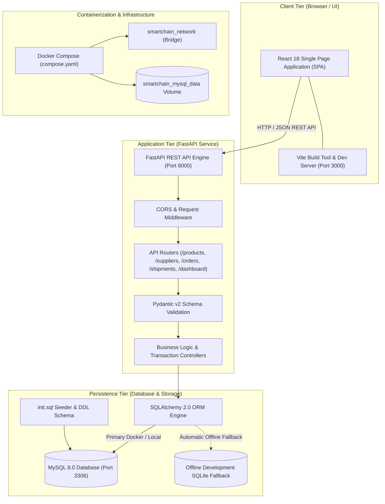
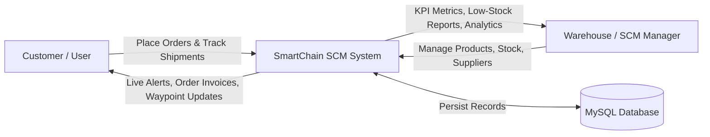
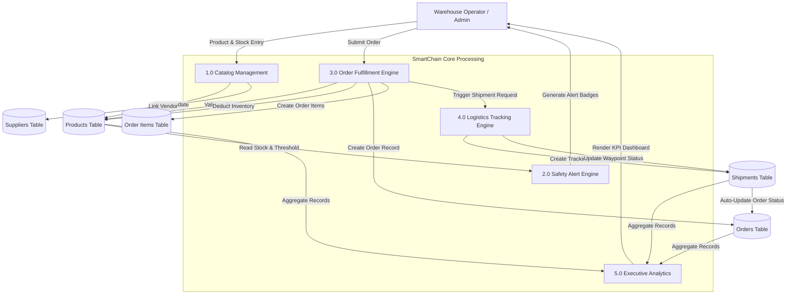
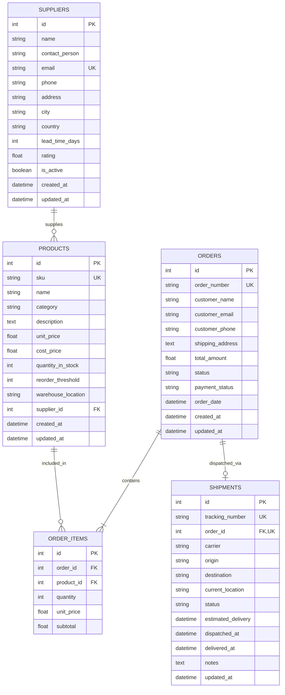

# SmartChain – Architecture & Database Design

---

## 1. System Architecture Diagram

---

## 2. Data Flow Diagram (DFD)

### Level 0: Context Diagram

### Level 1: Functional DFD

---

## 3. Entity Relationship (ER) Diagram

---

## 4. Database Data Dictionary

### Table 1: `suppliers`
| Column Name | Data Type | Constraints | Description |
|---|---|---|---|
| `id` | INT | PRIMARY KEY, AUTO_INCREMENT | Unique identifier for supplier |
| `name` | VARCHAR(150) | NOT NULL, INDEX | Supplier / vendor business name |
| `contact_person` | VARCHAR(100) | NULLABLE | Primary representative |
| `email` | VARCHAR(120) | NOT NULL, UNIQUE, INDEX | Official corporate email address |
| `phone` | VARCHAR(30) | NULLABLE | Direct contact phone number |
| `address` | VARCHAR(255) | NULLABLE | Street or industrial estate address |
| `city` | VARCHAR(100) | NULLABLE | Operating city |
| `country` | VARCHAR(100) | DEFAULT 'India' | Country of operation |
| `lead_time_days` | INT | DEFAULT 7 | Average fulfillment lead time in days |
| `rating` | FLOAT | DEFAULT 4.5 | Reliability score (1.0 to 5.0) |
| `is_active` | BOOLEAN | DEFAULT TRUE | Operational active flag |
| `created_at` | TIMESTAMP | DEFAULT CURRENT_TIMESTAMP | Registration timestamp |
| `updated_at` | TIMESTAMP | DEFAULT CURRENT_TIMESTAMP ON UPDATE | Last modification timestamp |

### Table 2: `products`
| Column Name | Data Type | Constraints | Description |
|---|---|---|---|
| `id` | INT | PRIMARY KEY, AUTO_INCREMENT | Unique catalog product ID |
| `sku` | VARCHAR(50) | NOT NULL, UNIQUE, INDEX | Unique Stock Keeping Unit code |
| `name` | VARCHAR(150) | NOT NULL, INDEX | Product commercial name |
| `category` | VARCHAR(100) | NOT NULL, INDEX | Classification (Electronics, Hardware, etc.) |
| `description` | TEXT | NULLABLE | Technical or physical description |
| `unit_price` | DECIMAL(10,2) | NOT NULL, DEFAULT 0.00 | Selling price per unit (INR) |
| `cost_price` | DECIMAL(10,2) | DEFAULT 0.00 | Procurement cost price per unit |
| `quantity_in_stock` | INT | NOT NULL, DEFAULT 0 | Real-time physical inventory quantity |
| `reorder_threshold` | INT | NOT NULL, DEFAULT 10 | Minimum safety threshold for alerts |
| `warehouse_location`| VARCHAR(50) | DEFAULT 'Aisle 1' | Bin / Rack / Aisle physical location |
| `supplier_id` | INT | NULLABLE, FOREIGN KEY (`suppliers.id`) | Primary vendor link |
| `created_at` | TIMESTAMP | DEFAULT CURRENT_TIMESTAMP | Creation timestamp |
| `updated_at` | TIMESTAMP | DEFAULT CURRENT_TIMESTAMP ON UPDATE | Last inventory/price update |

### Table 3: `orders`
| Column Name | Data Type | Constraints | Description |
|---|---|---|---|
| `id` | INT | PRIMARY KEY, AUTO_INCREMENT | Internal order record key |
| `order_number` | VARCHAR(50) | NOT NULL, UNIQUE, INDEX | Business order reference (`ORD-YYYYMMDD-XXXX`) |
| `customer_name` | VARCHAR(150) | NOT NULL | Customer or client company name |
| `customer_email` | VARCHAR(120) | NOT NULL | Customer contact email |
| `customer_phone` | VARCHAR(30) | NULLABLE | Customer phone number |
| `shipping_address`| TEXT | NOT NULL | Delivery destination address |
| `total_amount` | DECIMAL(12,2) | NOT NULL, DEFAULT 0.00 | Total invoiced order amount (INR) |
| `status` | VARCHAR(50) | NOT NULL, DEFAULT 'Pending' | Pending, Processing, Shipped, Delivered, Cancelled |
| `payment_status` | VARCHAR(50) | DEFAULT 'Paid' | Paid, Pending, Refunded |
| `order_date` | TIMESTAMP | DEFAULT CURRENT_TIMESTAMP | Order submission datetime |
| `created_at` | TIMESTAMP | DEFAULT CURRENT_TIMESTAMP | Record creation timestamp |
| `updated_at` | TIMESTAMP | DEFAULT CURRENT_TIMESTAMP ON UPDATE | Last status modification timestamp |

### Table 4: `order_items`
| Column Name | Data Type | Constraints | Description |
|---|---|---|---|
| `id` | INT | PRIMARY KEY, AUTO_INCREMENT | Primary line item ID |
| `order_id` | INT | NOT NULL, FOREIGN KEY (`orders.id`) ON DELETE CASCADE | Parent order link |
| `product_id` | INT | NOT NULL, FOREIGN KEY (`products.id`) | Catalog item link |
| `quantity` | INT | NOT NULL | Quantity ordered |
| `unit_price` | DECIMAL(10,2) | NOT NULL | Frozen unit price at time of purchase |
| `subtotal` | DECIMAL(12,2) | NOT NULL | Computed line total (`quantity * unit_price`) |

### Table 5: `shipments`
| Column Name | Data Type | Constraints | Description |
|---|---|---|---|
| `id` | INT | PRIMARY KEY, AUTO_INCREMENT | Unique shipment record ID |
| `tracking_number` | VARCHAR(60) | NOT NULL, UNIQUE, INDEX | Public tracking code (`TRK-SC-XXXXXX`) |
| `order_id` | INT | NOT NULL, UNIQUE, FOREIGN KEY (`orders.id`) | 1-to-1 link with order |
| `carrier` | VARCHAR(80) | NOT NULL | BlueDart, FedEx, DHL, etc. |
| `origin` | VARCHAR(150) | NOT NULL | Dispatch warehouse hub |
| `destination` | VARCHAR(255) | NOT NULL | Delivery target destination |
| `current_location`| VARCHAR(150) | NOT NULL | Current waypoint checkpoint |
| `status` | VARCHAR(50) | DEFAULT 'In Transit' | In Transit, Out for Delivery, Delivered, Delayed |
| `estimated_delivery`| TIMESTAMP | NULLABLE | Anticipated delivery timestamp |
| `dispatched_at` | TIMESTAMP | DEFAULT CURRENT_TIMESTAMP | Departure timestamp |
| `delivered_at` | TIMESTAMP | NULLABLE | Verified receipt timestamp |
| `notes` | TEXT | NULLABLE | Transit remarks or driver observations |
| `updated_at` | TIMESTAMP | DEFAULT CURRENT_TIMESTAMP ON UPDATE | Last tracking status change |
