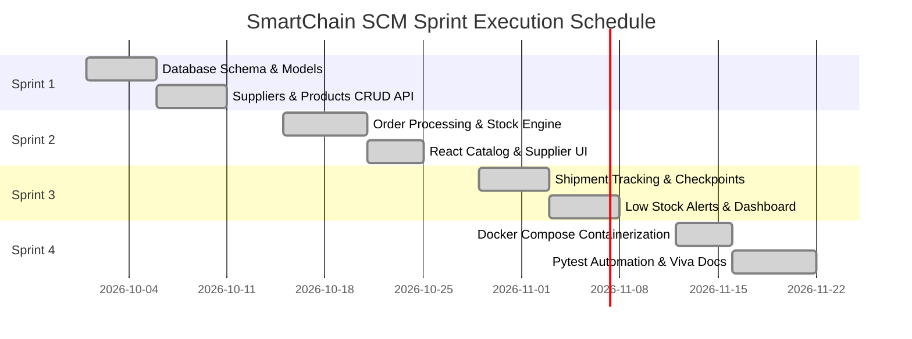
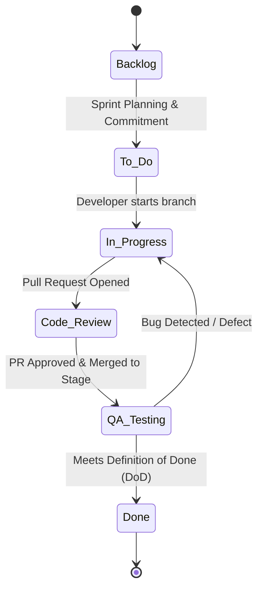

# SmartChain – Jira Agile Project Management Guide

---

## 1. Project Overview & Agile Framework
- **Project Name:** SmartChain – Supply Chain Management System
- **Project Key:** `SCM`
- **Agile Methodology:** Scrum with 2-week Sprint cycles
- **Estimation Methodology:** Story Points (Fibonacci Sequence: 1, 2, 3, 5, 8)
- **Tooling:** Atlassian Jira Software (Free Cloud Tier for up to 10 users)

---

## 2. Jira Epics Breakdown

| Epic Key | Epic Name | Description | Total Story Points |
|---|---|---|---|
| **SCM-EPIC-1** | Product & Inventory Master | Catalog administration, SKU management, warehouse allocation | 13 SP |
| **SCM-EPIC-2** | Supplier Relationship Management | Vendor onboarding, rating system, delivery lead-time tracking | 8 SP |
| **SCM-EPIC-3** | Customer Order Fulfillment | Inbound orders, line item calculations, atomic stock deduction | 16 SP |
| **SCM-EPIC-4** | Shipment Tracking & Waypoints | Carrier integration, tracking number dispatch, checkpoint updates | 13 SP |
| **SCM-EPIC-5** | Automated Safety Stock Alerts | Under-threshold detection, reorder deficit calculation, restock | 8 SP |
| **SCM-EPIC-6** | Executive SCM Dashboard | High-level KPI tiles, category charts, recent activities feed | 11 SP |
| **SCM-EPIC-7** | DevOps & Containerization | Docker multi-stage builds, compose orchestration, test automation | 11 SP |

---

## 3. User Stories with Acceptance Criteria & Story Points

### Epic 1: Product & Inventory Master (`SCM-EPIC-1`)
#### SCM-101: Create and Catalog Products
- **Type:** User Story
- **Story Points:** 5 | **Priority:** High
- **Assignee:** Backend Engineer + Frontend Engineer
- **Description:** *As a warehouse inventory manager, I want to add new products with SKU, category, price, and initial stock so that our inventory catalog reflects all available items.*
- **Acceptance Criteria:**
  - `Given` valid product details (unique SKU, name, positive price, quantity >= 0),
  - `When` the user submits the creation form,
  - `Then` the product is stored in the database with HTTP 201 status and displayed on the UI.
  - `Given` a duplicate SKU,
  - `When` submission is attempted,
  - `Then` the API rejects the request with HTTP 400 error message *"Product with SKU already exists"*.

#### SCM-102: Search and Filter Catalog
- **Type:** User Story
- **Story Points:** 3 | **Priority:** Medium
- **Assignee:** Frontend Engineer
- **Description:** *As a warehouse supervisor, I want to search products by name or SKU and filter by category so that I can locate inventory instantly.*
- **Acceptance Criteria:**
  - Search input filters the list in real-time or upon pressing Enter.
  - Category dropdown restricts items to the selected industry domain.

---

### Epic 2: Supplier Relationship Management (`SCM-EPIC-2`)
#### SCM-201: Supplier Directory & Lead Time Tracking
- **Type:** User Story
- **Story Points:** 5 | **Priority:** High
- **Assignee:** Backend Engineer
- **Description:** *As a procurement manager, I want to register supplier profiles with lead times and quality ratings so that I can select the most reliable vendor for restocking.*
- **Acceptance Criteria:**
  - System captures name, email, phone, city, average lead time (days), and rating (1.0 to 5.0).
  - Validation ensures valid email formats and non-negative lead times.

---

### Epic 3: Customer Order Processing (`SCM-EPIC-3`)
#### SCM-301: Multi-Item Order Creation with Stock Validation
- **Type:** User Story
- **Story Points:** 8 | **Priority:** Highest
- **Assignee:** Backend Engineer + QA Engineer
- **Description:** *As a customer sales officer, I want to create an order containing multiple line items so that customer purchases are recorded and stock is immediately reserved.*
- **Acceptance Criteria:**
  - Order creation atomically decrements `quantity_in_stock` for each product.
  - If requested quantity exceeds current stock, the transaction aborts with HTTP 400 and an informative error message.
  - Order is assigned a unique identifier formatted as `ORD-YYYYMMDD-XXXX`.

#### SCM-302: Order Status Lifecycle & Cancellation Replenishment
- **Type:** User Story
- **Story Points:** 5 | **Priority:** High
- **Assignee:** Backend Engineer
- **Description:** *As an operations manager, I want to update order statuses (Pending -> Processing -> Shipped -> Delivered -> Cancelled) so that when an order is cancelled, deducted inventory is automatically restored.*
- **Acceptance Criteria:**
  - Transitioning an order to `Cancelled` increments product stock back by the ordered quantities.

---

### Epic 4: Shipment Tracking & Logistics (`SCM-EPIC-4`)
#### SCM-401: Order Dispatch & Tracking Generation
- **Type:** User Story
- **Story Points:** 5 | **Priority:** High
- **Assignee:** Full Stack Engineer
- **Description:** *As a logistics coordinator, I want to dispatch an order and generate a tracking number so that customer transit progress is traceable.*
- **Acceptance Criteria:**
  - Generating a shipment automatically creates a `TRK-SC-XXXXXX` code and marks parent order as `Shipped`.

#### SCM-402: Live Public Waypoint Lookup
- **Type:** User Story
- **Story Points:** 3 | **Priority:** Medium
- **Assignee:** Frontend Engineer
- **Description:** *As a customer or dispatcher, I want to query a tracking number to see current checkpoint, carrier, and delivery status.*
- **Acceptance Criteria:**
  - Entering tracking number returns instant status card without needing full page reload.

---

### Epic 5: Automated Safety Stock Alerts (`SCM-EPIC-5`)
#### SCM-501: Low Stock Detection & Reorder Calculation
- **Type:** User Story
- **Story Points:** 5 | **Priority:** High
- **Assignee:** Backend Engineer + Frontend Engineer
- **Description:** *As an inventory planner, I want to receive alerts whenever item stock drops below its reorder threshold so that replenishment can happen before stockouts occur.*
- **Acceptance Criteria:**
  - Endpoint `/api/products/low-stock` returns items where `quantity_in_stock <= reorder_threshold`.
  - UI displays danger/warning badges and calculates suggested reorder quantity.

---

### Epic 6: Executive Analytics Dashboard (`SCM-EPIC-6`)
#### SCM-601: Real-time SCM Metrics Tiles & Graphs
- **Type:** User Story
- **Story Points:** 5 | **Priority:** High
- **Assignee:** Frontend Engineer
- **Description:** *As an operations director, I want a unified dashboard showing valuation, active shipments, low stock counts, and orders so that I can make data-driven decisions.*
- **Acceptance Criteria:**
  - Metrics update dynamically upon refresh or data updates.

---

### Epic 7: DevOps, Docker & Automation (`SCM-EPIC-7`)
#### SCM-701: Containerization with Docker Compose
- **Type:** User Story
- **Story Points:** 5 | **Priority:** High
- **Assignee:** DevOps Engineer
- **Description:** *As a system deployer, I want to launch the complete system (React, FastAPI, MySQL) using a single command so that the application runs identically on any environment.*
- **Acceptance Criteria:**
  - Running `docker compose up --build` boots all 3 containers with verified inter-service communication and database health checks.

---

## 4. Sprint Planning Roadmap (4 Sprints × 2 Weeks)

---

## 5. Jira Workflow Transition Lifecycle

### Definition of Done (DoD) Checklist:
1. All unit and integration test cases pass in Pytest with zero failures.
2. Code follows PEP8 (Python) and ESLint (React) formatting standards.
3. Database migrations or DDL changes execute cleanly without schema conflicts.
4. Input validation handled via Pydantic schemas with HTTP 400/422 status codes.
5. Container builds pass cleanly in `compose.yaml`.
6. Verified by QA Engineer against acceptance criteria.
